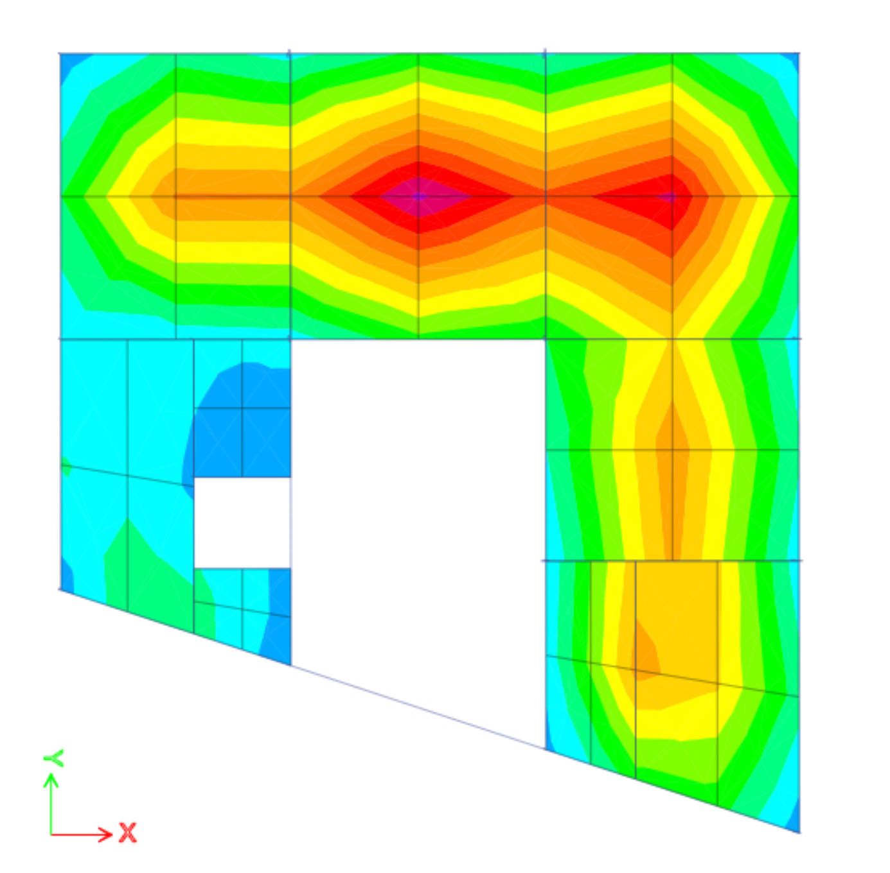

# G+1 Commercial Building: RC Frame Analysis and Design (ETABS)

  
  
  
  
  
  

A reinforced-concrete commercial building modelled from an AutoCAD centre-line drawing and analysed and designed in **ETABS 23** to Indian Standards, including seismic and wind loading and a concrete frame design check.

**Status:** ✅ Model, loading, analysis and concrete frame design check complete. Some modelling items are listed under [Review notes](#review-notes).

## Software and standards

| | |
|---|---|
| Software | ETABS Ultimate 23.2, AutoCAD (grid and column layout exported as DXF) |
| Concrete design | IS 456:2000 |
| Seismic load | IS 1893:2002, equivalent static method |
| Wind load | IS 875 (Part 3):1987 |

## Model

| Item | Value (from `Final File/G+1 Commerial_Building.e2k`) |
|---|---|
| Plan | Irregular plan, about 14.5 m × 15.3 m, 17 columns |
| Levels | Foundation (−2.0 m) → Plinth → First floor slab → Second floor slab → Roof slab → Tank and lift (3.0 m storeys above plinth) |
| Columns | C 300 × 600 mm, M25, HYSD500 bars, 20 mm cover |
| Beams | B 300 × 500 mm, M25, HYSD500 bars, 30 mm cover |
| Slabs | 150 mm, one-way (membrane) and two-way (thin shell) panels |
| Supports | Fixed at foundation level |
| Diaphragm | Rigid diaphragm (D1) at each floor |

## Loads

| Load | Value |
|---|---|
| Wall loads (calculated) | Exterior 0.2 × 20 × 2.5 = 10 kN/m · Interior 0.1 × 20 × 2.5 = 5 kN/m · Parapet 0.1 × 20 × 2.0 = 4 kN/m |
| Floor dead load | 3.0 kN/m² |
| Floor finish + ceiling plaster | 1.5 kN/m² (floors), 1.0 kN/m² (roof) |
| Roof live load | 1.5 kN/m² in the final model |
| Staircase | 4.0 kN/m² (live pattern) |
| Lift and water tank | 10 kN/m² (super dead) |
| Seismic | EQ X±, EQ Y± with 5 % accidental eccentricity, I = 1.2, R = 3, soil type II |
| Wind | Wind X±, Y±, Vb = 47 m/s, terrain category 3, Cp windward 0.8 / leeward 0.5 |

**Mass source:** Dead 1.0 + Wall load 1.0 + Live 0.25 + Staircase 0.5.

**Load combinations:** ETABS default IS 456 strength combinations (1.5DL, 1.5(DL + LL), 1.2(DL + LL ± WL), 1.5(DL ± WL), 0.9DL ± 1.5WL and the equivalent earthquake combinations).

## Workflow

1. Drafted the grid and column layout in AutoCAD and imported it as a DXF (all four sides of each column joined before export).
2. Defined materials, frame and slab sections, and storey levels.
3. Assigned supports, rigid diaphragms and slab auto-meshing (2 × 2 elements).
4. Calculated and assigned wall, floor, roof, staircase, lift/tank, seismic and wind loads.
5. Ran the analysis and checked storey displacements (Display → Story Response Plots).
6. Ran the concrete frame design check (Design → Concrete Frame Design → Design Check).

## Design check and revisions

The first design check failed, so I revised the members and re-ran the check:

| Member | Initial | Revised |
|---|---|---|
| Beams | B 200 × 500 mm | **B 300 × 500 mm**, cover 40 → 30 mm |
| Columns | C 200 × 600 mm | **C 300 × 600 mm** |

*Slab shell contour plot from the analysis (exported without a legend).*

## Review notes

Items found while reviewing the exported model, to fix in the next revision:

- The B 300 × 500 section is defined with a depth of 0.6 m in the model, so the beams are analysed as 300 × 600 mm.
- The seismic load patterns are not consistent: EQ X+ uses Z = 0.36, the other three use Z = 0.1, and EQ X− uses a user period of 0.1 s.
- Wind X+ uses structure class A; the other wind cases use class B.
- In the exported final model, only the 4 kN/m parapet load is assigned as a wall load, and no floor live-load pattern is assigned to the floor slabs.

## Files

| File | Description |
|---|---|
| `G+1 Commerial_Building.EDB` | ETABS model |
| `G+1 Commerial_Building 22.EDB` | Second version of the model |
| `Final File/G+1 Commerial_Building.e2k` | Text export of the final model (readable without ETABS) |
| `13 - commerical-center-line.dxf` | AutoCAD centre-line drawing used to build the model |
| `image.png` | Slab contour plot |

Open the `.EDB` files in ETABS 23 or later and run the analysis to regenerate results.
