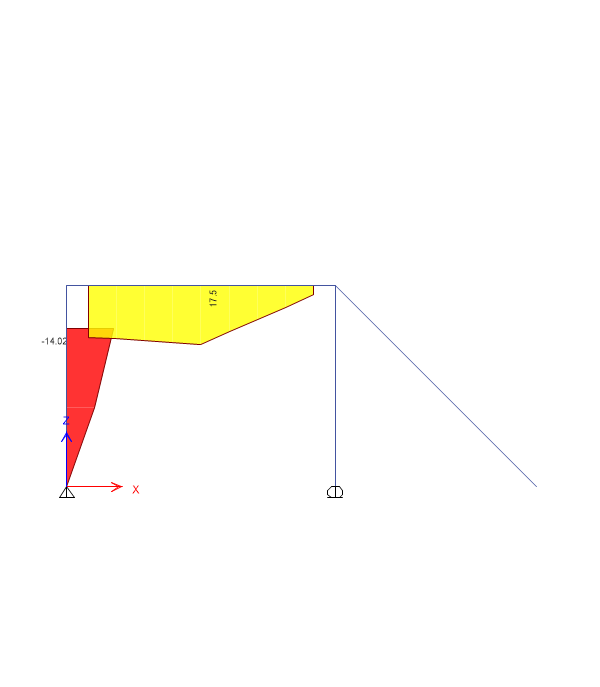
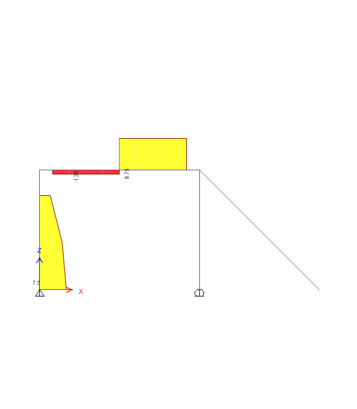

# Simply Supported Beam: Verification Model (ETABS)

A small beam/frame model used to practise ETABS modelling and to read bending-moment and shear-force diagrams.

**Status:** 🟡 Practice model. Analysis complete; diagrams exported under the Dead load case.

| Bending moment 3-3 (Dead, kN·m) | Shear force 2-2 (Dead, kN) |
|---|---|
|  |  |

PDF exports: [Moment 3-3.pdf](Moment%203-3.pdf) · [Shear 2-2.pdf](../Shear%202-2.pdf)

## Skills shown

- Defining supports, members and loads in ETABS
- Reading bending-moment and shear-force diagrams and sign conventions

## Files

| File | Description |
|---|---|
| `Simply Supported Beam.EDB` | ETABS model |
| `Beam/123.EDB` | Second version of the model |
| `Beam/*.bmp`, `Moment 3-3.pdf` | Original ETABS exports |
| `images/*.png` | PNG copies used in this README |
