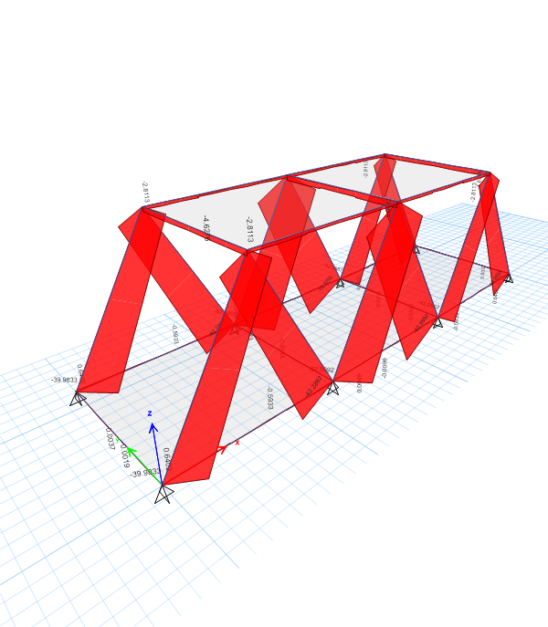
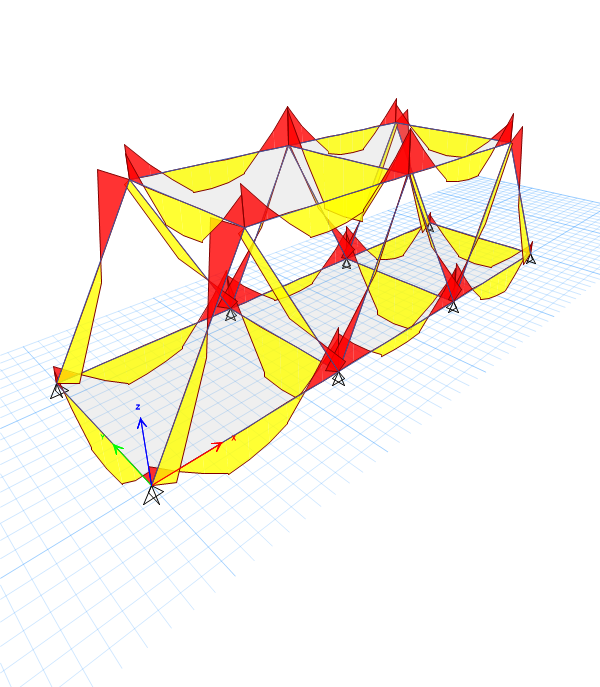
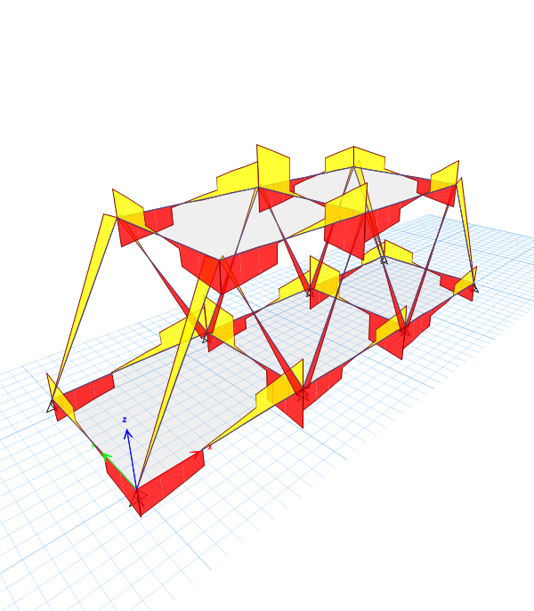
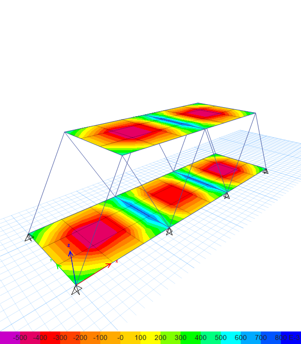

# Steel Truss Bridge Model (ETABS)

A small steel bridge-type frame with two deck slabs connected by inclined members, analysed in ETABS to read member forces and slab stresses.

**Status:** 🟡 Practice model. Analysis complete and result diagrams exported; no member design or written calculations yet.

## Results exported from ETABS

| Axial force | Bending moment 3-3 |
|---|---|
|  |  |
| **Shear force 2-2** | **Shell stress contour** |
|  |  |

**What the diagrams show:**

- The inclined members carry the load mainly by **axial force**, which is the expected behaviour of truss members.
- The deck slabs show stress concentrations at mid-panel, with reversed stresses along the lines where the panels are supported.

## Skills shown

- Modelling steel frame members and shell decks in ETABS
- Assigning pinned supports and loads
- Producing and interpreting axial, shear, moment and shell-stress diagrams

## Next steps

- Document the geometry, sections and loads in this README
- Run the steel frame design check and report utilisation ratios

## Files

| File | Description |
|---|---|
| `Truss Bridge.EDB` | ETABS model |
| `*.bmp` | Original result screenshots exported from ETABS |
| `images/*.png` | PNG copies of the screenshots used in this README |

Open the `.EDB` file in ETABS and run the analysis to regenerate the results.
